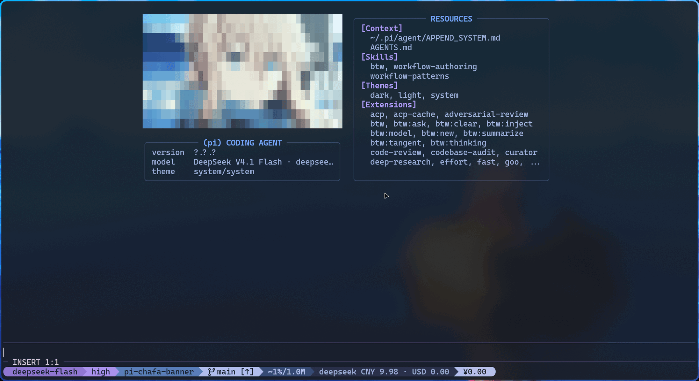

# pi-chafa-banner

[](https://www.npmjs.com/package/pi-chafa-banner)

Your favourite GIF, redrawn as terminal character art and parked in [pi](https://github.com/earendil-works/pi)'s
startup header — it scrolls away with the conversation, never steals focus, and
never touches a keystroke.



<sub>A real session: gif on the left, <code>(pi) CODING AGENT</code> below it, resources on the right — tokyonight palette.</sub>

## Quick start

Install it as a pi package — published on npm as
[`pi-chafa-banner`](https://www.npmjs.com/package/pi-chafa-banner):

```bash
pi install npm:pi-chafa-banner        # add it to ~/.pi/agent/settings.json
pi -e npm:pi-chafa-banner             # or just try it for one run
```

You need `chafa` and `ffmpeg` on your `PATH` — `/splash status` tells you what it
found. No config file? The bundled artwork shows up.

Prefer to hack on the code? Clone it next to pi's other extensions:

```bash
git clone https://github.com/XiaoCRQ/pi-chafa-banner ~/.pi/agent/pi-chafa-banner
cd ~/.pi/agent/pi-chafa-banner && bun install
```

and point pi at the extension directly:

```json
{ "extensions": ["~/.pi/agent/pi-chafa-banner/src/index.ts"] }
```

Want to see the layout without starting pi? There is a previewer for that:

```bash
bun run scripts/preview.ts --width 100                     # characters, colours on
bun run scripts/preview.ts --width 60                      # narrow, stacked layout
bun run scripts/preview.ts --static --theme pi             # follow pi's theme tokens
```

`bash scripts/demo.sh --preview` does the same after printing which config file
would be used, and `bash scripts/demo.sh` starts pi with **only this banner**
loaded (`pi --no-extensions -e .`), which is the cleanest way to check that the
splash is what you think it is.

## Configuration

Drop a `pi-chafa-banner.json` next to the extension: `~/.pi/agent/pi-chafa-banner.json`
for a clone in the agent dir, `<project>/.pi/pi-chafa-banner.json` for a project
install, and `~/.pi/agent/npm/node_modules/pi-chafa-banner/pi-chafa-banner.json`
for an npm package install (`/splash status` prints the exact path it reads).
Everything is optional — a missing key, a typo or a nonsense value just falls
back to the default for that key, and `/splash status` tells you which ones it
ignored.

```json
{
  "image": {
    "path": "~/Pictures/logo/v-3.gif",
    "fps": "auto",
    "stride": 3,
    "chafa": "--symbols block"
  },
  "layout": { "width": 88, "gap": 2 },
  "panels": { "info": { "fields": ["version", "model", "theme"] } },
  "theme": { "preset": "tokyonight" }
}
```

| Key | Default | Meaning |
| --- | --- | --- |
| `image.path` | `~/Pictures/logo/v-3.gif`, else the bundled artwork | Which GIF to animate (`~` expands) |
| `image.fps` / `image.stride` | `"auto"` / `3` | `"auto"` plays at the gif's own pace; `stride` keeps every Nth frame |
| `image.chafa` | `""` | Extra chafa flags, one string, e.g. `"--symbols block -c 16"` |
| `layout.width` / `layout.gap` | `88` / `2` | Overall width; the two columns split it evenly and the art canvas follows |
| `layout.twoColumnMinWidth` / `compactMinWidth` | `76` / `32` | Below these the panels stack, then collapse into three lines |
| `panels.info.enabled` / `.fields` | `true` / version, model, theme | Also `gif`, `frames` |
| `panels.resources.enabled` / `.sections` | `true` / all four | `context`, `skills`, `themes`, `extensions` |
| `panels.resources.maxLinesPerSection` | `6` | Lines per section before it trails off with `…` |
| `panels.resources.width` / `.height` | `"auto"` / `"auto"` | Ignored side-by-side: the panel is exactly as wide as the art column |
| `theme.preset` | `"tokyonight"` | Pins the dark palette below; `pi` follows pi's active theme instead |
| `theme.windowTitle` / `.sectionTitle` / `.border` / `.content` | preset | Four colour roles, any `#rgb` / `#rrggbb` — see below |
| `behavior.enabled` / `.static` / `.hidePiResourceList` | `true` / `false` / `true` | Master switch, freeze on one frame, hide pi's own resource list |

Three flags are quietly dropped from `image.chafa`: `--probe` (chafa would wait
for a terminal reply and steal pi's stdin), `--animate` (breaks one-frame-at-a-time)
and `--clear` (wipes the screen). `pi-chafa-banner.schema.json` describes every key
if you want autocompletion in your editor.

### Colours

`theme` paints the four parts of every box and nothing else. The default
`"preset": "tokyonight"` pins the dark palette below, so the splash looks the same
on every terminal; `"preset": "pi"` drops back to pi's own theme tokens, which is
what you want on a light terminal. Any single role can be overridden with a hex
colour either way:

```json
{
  "theme": {
    "preset": "tokyonight",
    "windowTitle": "#7aa2f7",
    "sectionTitle": "#bb9af7",
    "border": "#3b4261",
    "content": "#a9b1d6"
  }
}
```

| Role | What it paints | `tokyonight` |
| --- | --- | --- |
| `windowTitle` | Box titles: `RESOURCES`, `(pi) CODING AGENT`, `IMAGE` | `#7aa2f7` blue |
| `sectionTitle` | `[Context]`, `[Skills]`, `[Themes]`, `[Extensions]` | `#bb9af7` purple |
| `border` | Box edges, and the dashes either side of a title | `#3b4261` comment |
| `content` | Info values, resource names, the status line | `#a9b1d6` foreground |

An explicit hex always wins over the preset, so `{"preset": "tokyonight",
"border": "#ff0000"}` keeps the palette and only recolours the frames. Setting
`content` collapses pi's `text`/`muted`/`dim` trio into one colour — under
`"preset": "pi"` leaving it out keeps that three-step hierarchy. Colours are
emitted as 24-bit SGR for `truecolor` and as the nearest palette entry for
`256color`, matching what pi reports for your terminal.
`bun run scripts/preview.ts --color border=#ff0000` recolours the frames without
restarting pi.

## Commands

| Command | Effect |
| --- | --- |
| `/splash off` / `on` | Hand the header back to pi / take it over again |
| `/splash freeze` | Hold the current frame — and unfreeze it |
| `/splash rebuild` | Re-run the pipeline and rewrite the cache |
| `/splash reload` | Re-read `pi-chafa-banner.json` and rebuild |
| `/splash status` | Effective config, cache state, detected tools, warnings |

## Credits

- [beautiful-pi](https://github.com/danielmrdev/beautiful-pi) is the inspiration.
- [chafa](https://hpjansson.org/chafa/) draws the art, `ffmpeg` pulls the frames.

> Curious how it works? [docs/ARCHITECTURE.md](https://github.com/XiaoCRQ/pi-chafa-banner/blob/main/docs/ARCHITECTURE.md)
> has the module map, the data flow and the invariants.
>
> A native kitty-image version waits on the `archive/kitty-native-images` branch.

中文说明：[README.zh-CN.md](https://github.com/XiaoCRQ/pi-chafa-banner/blob/main/README.zh-CN.md).

MIT licensed, see [LICENSE](https://github.com/XiaoCRQ/pi-chafa-banner/blob/main/LICENSE).
