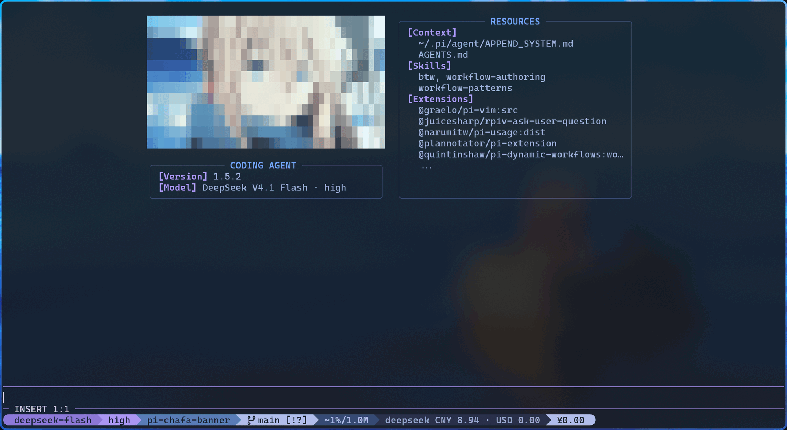

# pi-chafa-banner

[](https://www.npmjs.com/package/pi-chafa-banner)

把一张喜欢的 GIF 变成终端里的字符画，安稳地摆在 [pi](https://github.com/earendil-works/pi)
的启动页——它会跟着对话一起往上滚，不抢焦点，也不碰你的键盘。



<sub>真机截图：左边字符画、下面 <code>CODING AGENT</code>、右侧资源面板——示例用的是 tokyonight 配色。</sub>

## 快速开始

按 pi 包的方式安装，npm 上的包名叫
[`pi-chafa-banner`](https://www.npmjs.com/package/pi-chafa-banner)：

```bash
pi install npm:pi-chafa-banner        # 写进 ~/.pi/agent/settings.json
pi -e npm:pi-chafa-banner             # 或者只跑一次试试
```

需要 `chafa` 和 `ffmpeg` 在 `PATH` 里（`/splash status` 会告诉你找到没找到）。
没有配置文件也没关系，包内自带一张图。

想改代码？把它克隆到 pi 的扩展目录旁边：

```bash
git clone https://github.com/XiaoCRQ/pi-chafa-banner ~/.pi/agent/pi-chafa-banner
cd ~/.pi/agent/pi-chafa-banner && bun install
```

然后在 pi 的设置里加上它：

```json
{ "extensions": ["~/.pi/agent/pi-chafa-banner/src/index.ts"] }
```

不想启动 pi、只想先看看排版？有个预览器：

```bash
bun run scripts/preview.ts --width 100                     # 字符画，带颜色
bun run scripts/preview.ts --width 60                      # 窄终端，上下堆叠
bun run scripts/preview.ts --static --theme pi             # 跟随 pi 主题 token
```

`bash scripts/demo.sh --preview` 会先打印用到的配置文件再走预览；`bash scripts/demo.sh`
则用 `pi --no-extensions -e .` 启动 pi——**只加载这个 banner**，其他插件全部关掉，
是确认「你看到的 splash 就是它画的」最干净的方式。

## 配置

把 `pi-chafa-banner.json` 放在扩展旁边就行：克隆在 agent 目录里是
`~/.pi/agent/pi-chafa-banner.json`，装进项目是 `<项目>/.pi/pi-chafa-banner.json`，
用 npm 包装的是 `~/.pi/agent/npm/node_modules/pi-chafa-banner/pi-chafa-banner.json`
（`/splash status` 会打印它实际读的路径）。

每个键都可以不写——文件缺失、键缺失、写错类型、数值离谱，都只会退回那一项的
默认值，`/splash status` 会列出它忽略了哪些。

```json
{
  "image": {
    "path": "~/Pictures/logo/v-3.gif",
    "fps": "auto",
    "stride": 3,
    "chafa": "--symbols block"
  },
  "layout": { "width": 88, "gap": 2 },
  "panels": { "info": { "fields": ["version", "model"] } },
  "theme": { "preset": "tokyonight" }
}
```

| 键 | 默认 | 说明 |
| --- | --- | --- |
| `image.path` | `~/Pictures/logo/v-3.gif`，找不到用包内图 | 要播放的 GIF（会展开 `~`） |
| `image.fps` / `image.stride` | `"auto"` / `3` | `"auto"` 按 GIF 自己的节奏播；`stride` 是每 N 帧取 1 帧 |
| `image.chafa` | `""` | 额外的 chafa 参数，一个字符串，比如 `"--symbols block -c 16"` |
| `layout.width` / `layout.gap` | `88` / `2` | 整体宽度；两列等分，字符画尺寸跟着推导，不用单独配 |
| `layout.twoColumnMinWidth` / `compactMinWidth` | `76` / `32` | 窄于前者改成上下堆叠，窄于后者退化成三行 |
| `panels.info.enabled` / `.fields` | `true` / version、model | `version` 是 pi 自身的版本号（取自 `pi -v`）；当前思考强度跟在 model 后面显示成 `· high`；还能加 `gif`、`frames` |
| `panels.resources.enabled` / `.sections` | `true` / 三项全开 | `context`、`skills`、`extensions` |
| `panels.resources.maxLinesPerSection` | `6` | 每个分类最多几行，超出收尾（名字被截断显示 `…`，Extensions 还有更多时最后一行是 `...`） |
| `panels.resources.width` / `.height` | `"auto"` / `"auto"` | 双栏时忽略：面板宽度恒等于图片列 |
| `theme.preset` | `"tokyonight"` | 锁定下面的深色配色；写 `pi` 改为跟随 pi 当前主题 |
| `theme.windowTitle` / `.sectionTitle` / `.border` / `.content` | 取预设 | 四个配色角色，写 `#rgb` 或 `#rrggbb` 即可覆盖——见下节 |
| `behavior.enabled` / `.static` / `.hidePiResourceList` | `true` / `false` / `true` | 总开关、冻结成静图、隐藏 pi 自带的资源列表 |

`image.chafa` 里有三个参数会被悄悄丢掉：`--probe`（chafa 会等终端应答，抢走
pi 的 stdin）、`--animate`（会破坏一帧一帧的输出）、`--clear`（会清屏）。
想让你编辑器补全这些键，旁边还有 `pi-chafa-banner.schema.json`。

### 配色

`theme` 只管四个地方的颜色，别的都不碰。默认 `"preset": "tokyonight"`，一套固定的
深色配色，任何终端上看起来都一样；写成 `"preset": "pi"` 则回落到 pi 自己的主题
token，浅色终端该用这个。任一角色还能单独用 hex 覆盖：

```json
{
  "theme": {
    "preset": "tokyonight",
    "windowTitle": "#7aa2f7",
    "sectionTitle": "#bb9af7",
    "border": "#3b4261",
    "content": "#a9b1d6"
  }
}
```

| 角色 | 画在哪 | `tokyonight` |
| --- | --- | --- |
| `windowTitle` | 窗口标题：`RESOURCES`、`CODING AGENT`、`IMAGE` | `#7aa2f7` 蓝 |
| `sectionTitle` | 标签标题：`[Context]`、`[Skills]`、`[Extensions]`、`[Version]`、`[Model]` | `#bb9af7` 紫 |
| `border` | 窗口边框，以及标题两侧的横线 | `#3b4261` 注释灰 |
| `content` | 窗口内容：字段值、资源名、状态行 | `#a9b1d6` 正文色 |

显式写的 hex 永远压过预设，所以 `{"preset": "tokyonight", "border": "#ff0000"}`
会保留整套配色、只把边框换成红色。写了 `content` 就等于用一种颜色顶掉 pi 的
`text`/`muted`/`dim` 三档；`"preset": "pi"` 时不写它才能保住这三档层次。颜色在
`truecolor` 下输出 24 位 SGR，`256color` 下取最近的调色板项，跟 pi 报告给你的终端
能力一致。`bun run scripts/preview.ts --color border=#ff0000` 可以不重启 pi 直接看
效果。

## 命令

| 命令 | 作用 |
| --- | --- |
| `/splash off` / `on` | 把 header 还给 pi / 再拿回来 |
| `/splash freeze` | 停在当前这一帧——再按一次继续播 |
| `/splash rebuild` | 重跑一遍管线，重写缓存 |
| `/splash reload` | 重新读 `pi-chafa-banner.json` 并重建 |
| `/splash status` | 生效的配置、缓存状态、检测到的工具、警告 |

## 致谢

- [beautiful-pi](https://github.com/danielmrdev/beautiful-pi) 灵感来源
- [chafa](https://hpjansson.org/chafa/) 渲染字符画，`ffmpeg` 抽帧。

> 想了解实现：[docs/ARCHITECTURE.md](https://github.com/XiaoCRQ/pi-chafa-banner/blob/main/docs/ARCHITECTURE.md)
> 里有模块划分、数据流和不变式。
>
> kitty 原生图片版本留在 `archive/kitty-native-images` 分支，等以后再说。

English: [README.md](https://github.com/XiaoCRQ/pi-chafa-banner/blob/main/README.md)。

MIT 许可，见 [LICENSE](https://github.com/XiaoCRQ/pi-chafa-banner/blob/main/LICENSE)。
